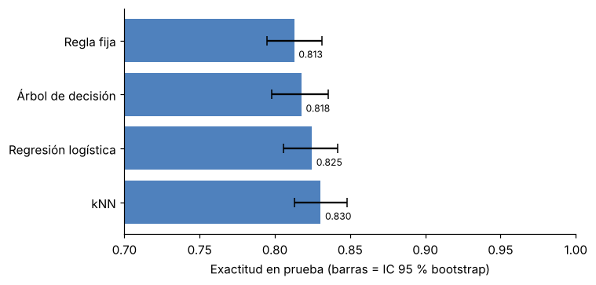
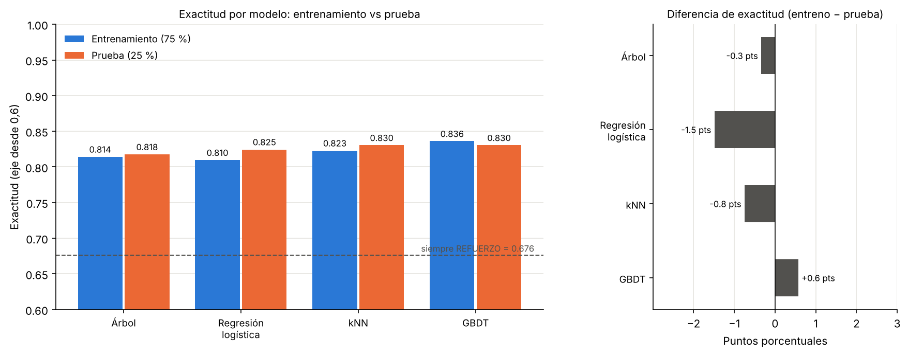
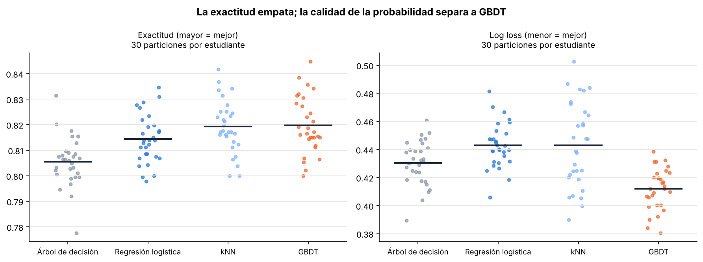
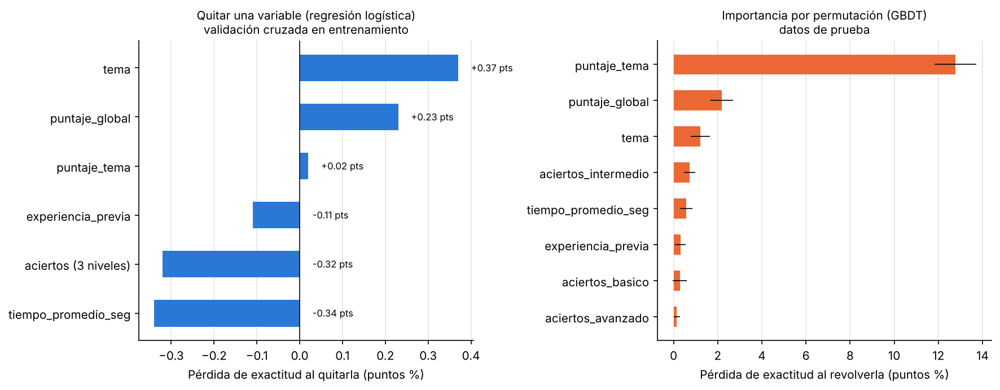

# CyberMind · Decisión de refuerzo o avance con aprendizaje de máquina

Proyecto universitario de Inteligencia Artificial. **CyberMind** es una plataforma de aprendizaje de ciberseguridad; este repositorio contiene **solo el componente de IA**: el servicio que, después de una evaluación diagnóstica, decide si un estudiante debe hacer **REFUERZO** de un tema o puede pasar al **AVANCE**.

El repositorio muestra el avance de las pruebas: cómo se generó el dataset, qué modelos se probaron, con qué resultados y cómo reproducir todo.

> **Estado (noviembre 2026):** dataset sintético validado, 5 métodos comparados (regla fija + 4 modelos de ML), evaluación entrenamiento vs. prueba terminada y **modelo seleccionado: Gradient Boosting (GBDT)**, elegido por la calidad de su probabilidad (ver [fase 3](#fase-3--selección-del-modelo)).

---

## Contenido

1. [Problema](#1-problema)
2. [Dataset sintético](#2-dataset-sintético)
3. [Modelos probados](#3-modelos-probados)
4. [Resultados](#4-resultados)
5. [Modelo final para la app](#5-modelo-final-para-la-app)
6. [Estructura del repositorio](#6-estructura-del-repositorio)
7. [Cómo reproducir](#7-cómo-reproducir)
8. [Documentación](#8-documentación)
9. [Próximos pasos](#9-próximos-pasos)
10. [Equipo](#10-equipo)

---

## 1. Problema

Tras la retroalimentación del Avance II, el alcance se redujo a **una sola decisión mínima y verificable**:

| | |
|---|---|
| **Entrada** | Resultado del diagnóstico de un estudiante en un tema: 9 preguntas (3 básico, 3 intermedio, 3 avanzado), puntajes, tiempo promedio, tema y experiencia previa. |
| **Salida** | `REFUERZO` o `AVANCE` para ese par (estudiante, tema). |
| **Tipo de tarea** | Aprendizaje supervisado, clasificación binaria. Clase positiva: `REFUERZO`. |
| **Temas** | Fundamentos de redes, criptografía, seguridad web, ingeniería social, gestión de vulnerabilidades. |

La IA está **desacoplada de la app**: el modelo se entrena aquí, en Python, y se entrega como un archivo `.onnx` que la app ejecuta localmente en el celular (ver [sección 5](#5-modelo-final-para-la-app)). Para cambiar el modelo basta con reemplazar ese archivo. Si el modelo no carga, la app usa una ruta por defecto (refuerzo si el puntaje es menor a 70 %).

## 2. Dataset sintético

No hay datos reales de estudiantes, así que se generó un **dataset sintético reproducible** (semilla 42):

- **7.500 filas** = 1.500 estudiantes × 5 temas.
- Respuestas simuladas con **teoría de respuesta al ítem (IRT 3PL)**, con dificultad distinta por tema y por nivel de pregunta, e incluye un 4 % de "adivinadores rápidos".
- La etiqueta sale del **dominio real** simulado (criterio de mastery learning: AVANCE si la probabilidad de aprobar la unidad siguiente es ≥ 0,70) y se invierte un 5 % al azar para simular desacuerdo entre evaluadores.
- Distribución: **65,4 % REFUERZO / 34,6 % AVANCE**.

Variables de entrada (8): `tema`, `experiencia_previa`, `aciertos_basico`, `aciertos_intermedio`, `aciertos_avanzado`, `puntaje_tema`, `puntaje_global`, `tiempo_promedio_seg`. El campo `id_estudiante` no es entrada: solo se usa para que la partición entrenamiento/prueba sea **por estudiante** y no haya fuga de información.

Detalle completo de cada variable: [`data/diccionario_de_datos.md`](data/diccionario_de_datos.md).

> **Regla del proyecto:** el único archivo de datos que usan las pruebas y los notebooks es `data/cybermind_sintetico.csv`. El generador también puede producir `cybermind_sintetico_oculto.csv` (variables latentes del simulador), pero ese archivo **no está en el repositorio** (`.gitignore`) y **no se usa** en ninguna prueba.

## 3. Modelos probados

Todos usan la **misma partición**: 75 % entrenamiento / 25 % prueba, agrupada por estudiante (`GroupShuffleSplit`, `random_state=0`): 5.625 filas para entrenar y 1.875 para probar.

| # | Método | Tipo | Configuración |
|---|---|---|---|
| 0 | Regla fija | Línea base (no se entrena) | AVANCE si `puntaje_tema` ≥ 70 |
| 1 | Árbol de decisión (CART) | ML, interpretable | profundidad 4, ≥ 50 muestras por hoja |
| 2 | Regresión logística | ML, lineal | regularización L2, C = 1, variables estandarizadas |
| 3 | k vecinos más cercanos (kNN) | ML, basado en instancias | k = 51, distancia Manhattan; elegido con validación cruzada agrupada (5 particiones) |
| 4 | Gradient Boosting (GBDT) | ML, ensamble de árboles | 100 árboles, profundidad 3 (también se probó con búsqueda de hiperparámetros) |

## 4. Resultados

### Fase 1 · Comparación de métodos (conjunto de prueba)

| Método | Exactitud | IC 95 % | F1 (REFUERZO) | Recall (REFUERZO) |
|---|---|---|---|---|
| Siempre REFUERZO (referencia) | 0,676 | | | |
| Regla fija | 0,813 | [0,795; 0,832] | 0,862 | 0,866 |
| Árbol de decisión | 0,818 | [0,798; 0,836] | 0,869 | 0,898 |
| Regresión logística | 0,825 | [0,806; 0,842] | 0,874 | 0,899 |
| kNN | 0,830 | [0,813; 0,848] | 0,877 | 0,894 |
| GBDT | 0,831 | [0,813; 0,849] | 0,878 | 0,902 |

El IC 95 % se calculó con bootstrap por estudiante. **Los intervalos se solapan**: con estos datos los modelos quedan prácticamente empatados.



*La gráfica muestra los 4 primeros métodos (cuaderno de la fase 1); GBDT se añadió después con `05_gbdt.py`.*

### Fase 2 · Entrenamiento (75 %) vs. prueba (25 %)

Se pidió comprobar si los modelos sobreajustan comparando su desempeño en entrenamiento y en prueba.

| Modelo | Exactitud entreno | Exactitud prueba | Diferencia | F1 entreno | F1 prueba |
|---|---|---|---|---|---|
| Árbol de decisión (CART) | 0,814 | 0,818 | −0,003 | 0,861 | 0,869 |
| Regresión logística | 0,810 | 0,825 | −0,015 | 0,857 | 0,874 |
| kNN | 0,823 | 0,830 | −0,008 | 0,866 | 0,877 |
| GBDT | 0,836 | 0,830 | +0,006 | 0,877 | 0,878 |

**Lectura:** ningún modelo muestra sobreajuste (diferencias menores a 1,5 puntos). En prueba los cuatro quedan entre **0,818 y 0,830** de exactitud.



Cada modelo tiene además su propia figura (matriz de confusión y métricas) en [`pruebas/fase2_entreno_vs_prueba/resultados/`](pruebas/fase2_entreno_vs_prueba/resultados/).

### Fase 3 · Selección del modelo

Como la exactitud de los cuatro modelos está empatada, el profesor recomendó buscar un factor que destaque a uno sobre los demás. El factor elegido es la **calidad de la probabilidad**: el servicio devuelve una probabilidad de REFUERZO y la app decide con ella (el umbral se puede subir para ser más prudente), así que esa probabilidad debe ser confiable.

Se repitió 30 veces la partición 75/25 por estudiante (semillas 100 a 129) con los mismos hiperparámetros de la fase 2 y se contó qué modelo gana en cada partición:

| Métrica (promedio de 30 particiones) | Árbol | Logística | kNN | GBDT | GBDT gana en |
|---|---|---|---|---|---|
| Log loss (menor = mejor) | 0,431 | 0,443 | 0,443 | **0,412** | 30 de 30 |
| AUC (mayor = mejor) | 0,861 | 0,857 | 0,871 | **0,874** | 28 de 30 |
| Brier (menor = mejor) | 0,136 | 0,138 | 0,131 | **0,129** | 26 de 30 |
| Avances sin dominio por partición | 152 | 136 | 139 | **131** | 16 de 30 |
| Exactitud | 0,806 | 0,814 | 0,819 | 0,820 | 17 de 30 |

**Modelo seleccionado: GBDT** (200 árboles, profundidad 3, tasa de aprendizaje 0,05, hoja mínima 20, submuestreo 0,8). Tiene el menor log loss en las 30 particiones, no sobreajusta (0,836 entreno / 0,830 prueba) y responde en unos 2,3 ms por estudiante. Su desventaja es que es menos interpretable; se compensa con la importancia de variables (abajo) y con la regla del 70 % como ruta por defecto.



### Relevancia de variables

`puntaje_tema` es la variable que más aporta (solo con ella se obtiene 0,813 en prueba frente a 0,825 con las 8). Quitar cualquier otra variable cambia la exactitud en menos de 0,5 puntos porque se solapan entre sí (`puntaje_tema` es la suma de los `aciertos_*`). El análisis completo está en [`docs/`](docs/).



> Estos resultados validan el procedimiento sobre **datos sintéticos**; no miden todavía el efecto pedagógico con estudiantes reales.

## 5. Modelo final para la app

El modelo elegido (GBDT) se entrena con el 100 % del dataset y se exporta en **un solo archivo**, [`modelo/cybermind_gbdt.onnx`](modelo/cybermind_gbdt.onnx) (unos 106 KB), para que la decisión se calcule **dentro del celular**, sin internet ni servidor.

**Por qué ONNX y no `.pkl` o `.h5`:** un `.pkl` solo lo abre Python, y en el celular no hay Python. El `.h5` es el formato de Keras/TensorFlow para redes neuronales; un GBDT de scikit-learn no se guarda así. ONNX es un formato abierto que [ONNX Runtime](https://onnxruntime.ai/) ejecuta en Android, iOS, Flutter y React Native.

| | |
|---|---|
| **Entradas** | Las 8 variables tal cual, cada una con forma `[1, 1]`: `tema` y `experiencia_previa` como texto; las 6 numéricas como `float32` |
| **Salidas** | `label` (1 = REFUERZO, 0 = AVANCE) y `probabilities` = `[prob. AVANCE, prob. REFUERZO]` |
| **Umbral** | REFUERZO si la probabilidad de REFUERZO es ≥ 0,5 |
| **Si el modelo no carga** | La app usa la ruta por defecto: REFUERZO si `puntaje_tema` < 70 |
| **Verificación** | En las 7.500 filas, el `.onnx` da las mismas decisiones que scikit-learn y sus probabilidades difieren en menos de 0,000001 |

El propio archivo guarda su versión, el umbral, los valores válidos de `tema` y `experiencia_previa` y las métricas de referencia (en `metadata_props`).

```bash
pip install skl2onnx onnxruntime
python src/entrenar_modelo_final.py    # entrena y genera modelo/cybermind_gbdt.onnx
python src/probar_modelo_onnx.py       # lo usa como la app: solo ONNX Runtime, sin scikit-learn
```

**En la app Android (Kotlin + Jetpack Compose):** el archivo va en `app/src/main/assets/` y se ejecuta con `com.microsoft.onnxruntime:onnxruntime-android`. El código que carga el modelo vive en el repositorio de la app: carga el modelo, arma las 8 entradas, devuelve la ruta con su probabilidad y aplica la ruta por defecto si el modelo no carga. La decisión puede guardarse luego en Supabase junto con la versión del modelo.

Las variables numéricas entran sin estandarizar: un árbol no cambia sus decisiones por la escala, y así el modelo del celular reproduce exactamente al de Python.

## 6. Estructura del repositorio

```
CyberMind-ML/
├── README.md
├── requirements.txt
├── .gitignore
├── data/
│   ├── cybermind_sintetico.csv          # dataset (7.500 filas, 10 columnas)
│   └── diccionario_de_datos.md          # descripción de variables y etiqueta
├── modelo/
│   └── cybermind_gbdt.onnx              # modelo final (GBDT) para la app del celular
├── src/
│   ├── generar_dataset.py               # genera el dataset (semilla 42)
│   ├── verificar_dataset.py             # comprueba que la etiqueta es aprendible
│   ├── entrenar_modelo_final.py         # entrena el GBDT final y genera el .onnx
│   └── probar_modelo_onnx.py            # usa el .onnx como lo haría la app
├── pruebas/
│   ├── fase1_comparacion_modelos/       # regla fija + 4 modelos, métricas en prueba
│   │   ├── 01_regla_fija.py
│   │   ├── 02_arbol_decision.py
│   │   ├── 03_regresion_logistica.py
│   │   ├── 04_knn.py
│   │   ├── 05_gbdt.py
│   │   ├── comparar_knn.py
│   │   └── resultados/                  # JSON por método + gráficas
│   ├── fase2_entreno_vs_prueba/         # 4 modelos: entrenamiento vs. prueba
│   │   ├── 01_arbol_decision.py
│   │   ├── 02_regresion_logistica.py
│   │   ├── 03_knn.py
│   │   ├── 04_gbdt.py
│   │   └── resultados/                  # JSON + PNG por modelo y comparación
│   └── fase3_seleccion_modelo/          # criterio de desempate: 30 particiones
│       ├── seleccion_modelo.py
│       └── resultados/
├── notebooks/
│   ├── 01_generacion_dataset.ipynb      # genera y explora el dataset
│   ├── 02_pruebas_modelos.ipynb         # fase 1 en un solo cuaderno
│   └── 03_entreno_vs_prueba.ipynb       # fase 2 en un solo cuaderno
└── docs/                                # documentos entregados al profesor
```

## 7. Cómo reproducir

Requisitos: Python 3.10 o superior.

```bash
git clone https://github.com/CyberMind-UNI/CyberMind-ML.git
cd CyberMind-ML
python -m venv .venv
source .venv/bin/activate          # Windows: .venv\Scripts\activate
pip install -r requirements.txt
```

Ejecutar las pruebas (desde la raíz del repositorio):

```bash
# Validar el dataset
python src/verificar_dataset.py

# Fase 1: comparación de métodos
python pruebas/fase1_comparacion_modelos/01_regla_fija.py
python pruebas/fase1_comparacion_modelos/02_arbol_decision.py
python pruebas/fase1_comparacion_modelos/03_regresion_logistica.py
python pruebas/fase1_comparacion_modelos/04_knn.py
python pruebas/fase1_comparacion_modelos/05_gbdt.py

# Fase 2: entrenamiento vs. prueba
python pruebas/fase2_entreno_vs_prueba/01_arbol_decision.py
python pruebas/fase2_entreno_vs_prueba/02_regresion_logistica.py
python pruebas/fase2_entreno_vs_prueba/03_knn.py
python pruebas/fase2_entreno_vs_prueba/04_gbdt.py

# Fase 3: selección del modelo (tarda unos minutos)
python pruebas/fase3_seleccion_modelo/seleccion_modelo.py
```

Cada script guarda sus resultados en la carpeta `resultados/` que tiene al lado. Con la semilla fija, los números salen iguales a los de este README.

Notebooks: `jupyter notebook notebooks/`, o abrirlos en Google Colab y subir `data/cybermind_sintetico.csv` al panel de archivos.

Regenerar el dataset (opcional, sale idéntico con la semilla 42):

```bash
python src/generar_dataset.py
```

## 8. Documentación

| Documento | Contenido |
|---|---|
| [`docs/Avance_II_CyberMind_corregido.docx`](docs/Avance_II_CyberMind_corregido.docx) | Planeación corregida tras la retroalimentación del Avance II |
| [`docs/Resumen_proyecto_CyberMind.docx`](docs/Resumen_proyecto_CyberMind.docx) | Resumen general del proyecto |
| [`docs/Documentacion_pruebas_modelos.docx`](docs/Documentacion_pruebas_modelos.docx) | Documentación de la fase 1 de pruebas |
| [`docs/Documentacion_CyberMind_problema_variables_modelos.docx`](docs/Documentacion_CyberMind_problema_variables_modelos.docx) | Problema, justificación de variables, modelos y comparación |
| [`docs/analisis_variables.json`](docs/analisis_variables.json) | Datos del análisis de relevancia de variables |

## 9. Próximos pasos

- [x] Elegir el modelo final con la recomendación del profesor (GBDT, fase 3).
- [ ] Cerrar la justificación de variables (posible retiro de `aciertos_basico`).
- [x] Exportar el modelo final para el celular (`modelo/cybermind_gbdt.onnx`).
- [ ] Integrar el `.onnx` en la app con ONNX Runtime.
- [ ] Validar con datos reales cuando estén disponibles.

## 10. Equipo

- David
- Nicolás
- Perrochueco67

Proyecto académico de Inteligencia Artificial, 2026.
